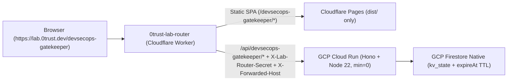

# Architecture — `0trust-lab-devsecops-gatekeeper` (Lab 4)

## Overview
`0trust-lab-devsecops-gatekeeper` is a standalone Model 1 Zero Trust interactive lab routed via `0trust-lab-router` at `https://lab.0trust.dev/devsecops-gatekeeper` (local dev: `http://localhost:5179` with Vite `/api` proxy → local Hono server on `:8080`). Static SPA assets (`dist/`) are hosted on Cloudflare Pages (`0trust-lab-devsecops-gatekeeper.pages.dev`), while `/api/devsecops-gatekeeper/*` requests are routed to a GCP Cloud Run backend backed by GCP Firestore Native (`kv_state`).

## Request Split & Runtime Topology

## Key Boundaries & Components
1. **2-Seat Role Switcher (`developer` ↔ `appsec-gate`)**:
   - **Platform Dev (`Jordan Lee`)**: Authors Pull Requests (`PR #418`–`PR #422`), triggers CI scans, remediates findings, and runs `Deploy PR`.
   - **AppSec Gatekeeper (`Sora Takahashi`)**: Inspects smoking-gun scanner findings in POE mode to unlock the OPA/Rego policy patcher, enforces all 4 admission clauses (`require_pinned_sha`, `block_secrets`, `require_cosign_oidc`, `block_public_acl`), and verifies keyless Cosign OIDC attestations.
2. **4-Phase Cognitive Arc + POE Gate**:
   - **Discovery**: Interactive 5-stage PR-to-Production pipeline map.
   - **Understanding (POE)**: Predict-Observe-Explain across 4 poisoned PR presets (`TYPOSQUAT_DEP`, `LEAKED_SECRET`, `UNPINNED_ACTION`, `PUBLIC_IAC_ACL`). Clicking the smoking-gun diff line unlocks Phase 3.
   - **Practice**: Live OPA/Rego policy patcher + PR remediation & `Deploy PR` runner.
   - **Reflection**: Security vs. velocity scorecard, trap checklist, and exportable JSON attestation bundle.
3. **Cloud Run Backend Adapter (`server/`) & Handler (`functions/api/devsecops-gatekeeper/evaluate-pr.ts`)**:
   - **HTTP Server (`server/app.ts`, `server/index.ts`)**: Hono + `@hono/node-server` container (`Dockerfile`, multi-stage `node:22-alpine`, non-root `USER node`, port `8080`) wrapping `functions/api/_middleware.ts` and `POST /api/devsecops-gatekeeper/evaluate-pr`.
   - **`GET /healthz`**: Returns `200 { ok: true, lab: "devsecops-gatekeeper" }` (exempt from `X-Lab-Router-Secret` for Cloud Run startup/liveness probes; touches no secrets or Firestore).
   - **Fail-Closed Origin Auth**: Constant-time `crypto.timingSafeEqual` verification of `X-Lab-Router-Secret` on all `/api/*` routes; returns `403 FORBIDDEN_DIRECT_ORIGIN` if missing/invalid or if `LAB_ROUTER_SECRET` is unset in `ENVIRONMENT=production`.
   - **Firestore KV Adapter (`server/kvAdapter.ts`)**: Implements `STATE_KV` (`get`, `put` with `expirationTtl: 3600`, `delete`) over GCP Firestore Native collection `kv_state` with document IDs `devsecops-gatekeeper:${encodeURIComponent(key)}` (key prefix `lab4:devsecops:<sessionId>`) and **synchronous TTL enforcement on read** (`expireAt <= Date.now()` returns `null`). Automatically falls back to `MemoryKvAdapter` during local `npm run dev` when no GCP credentials are present.
   - **Observability & Redaction (`functions/api/_middleware.ts`)**: Propagates W3C `traceparent`, injects `_telemetry` and `X-Edge-Latency-Ms`, redacts JWT signatures in `Authorization`, never leaks `X-Lab-Router-Secret` or `OTLP_AUTH_HEADER`, and supports optional non-blocking OTLP trace export.
   - **Fail-Closed Policy Gate**: Enforces `MAX_BODY_BYTES = 65536`, strict `Set`-based `pr_preset` validation, `sanitizeSessionId()`, and `Cache-Control: no-store`. Returns `HTTP 403 DENY` whenever any required OPA/Rego clause is disabled or any scanner finding is active; returns `HTTP 200 ALLOW` with synthetic Sigstore Cosign OIDC bundle only when `CLEAN_PR` and all 4 clauses pass.
   - **`$0/mo` Client Fallback**: When the API is unreachable, `src/engine/devsecopsEngine.ts` runs deterministic client-side evaluation with zero console errors.
4. **Infrastructure & CI/CD (`infra/terraform/`, `.github/workflows/deploy.yml`)**:
   - **Cloudflare Pages (Static SPA)**: `managed-infrastructure//modules/cloudflare-pages-lab` (`enable_custom_domain = false`). `deploy.yml` `deploy-pages` strips `functions/` and deploys `dist/` only.
   - **GCP Cloud Run API**: `managed-infrastructure//modules/cloud-run-lab` (`min_instance_count = 0`, `$0` idle cost, dedicated least-privilege runtime SA with `roles/datastore.user` and per-secret `roles/secretmanager.secretAccessor`). `deploy.yml` `deploy-cloudrun` authenticates via GitHub Actions WIF OIDC, builds/pushes to Artifact Registry (`0trust-labs/devsecops-gatekeeper:${GITHUB_SHA}`), and deploys to Cloud Run.
