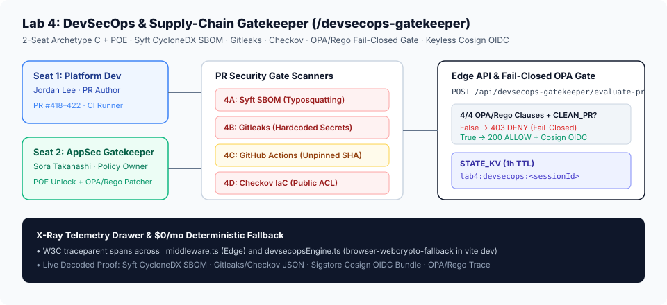
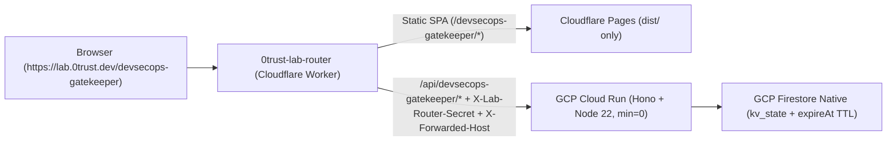

# Architecture — `0trust-lab-devsecops-gatekeeper` (Lab 4)

## Overview
`0trust-lab-devsecops-gatekeeper` is a standalone Model 1 Zero Trust interactive lab routed via `0trust-lab-router` at `https://lab.0trust.dev/devsecops-gatekeeper` (local dev: `http://localhost:5179` with Vite `/api` proxy → local Hono server on `:8080`). Static SPA assets (`dist/`) are hosted on Cloudflare Pages (`0trust-lab-devsecops-gatekeeper.pages.dev`), while `/api/devsecops-gatekeeper/*` requests are routed to a GCP Cloud Run backend backed by GCP Firestore Native (`kv_state`).

## Request Split & Runtime Topology

## Key Boundaries & Components
1. **AppShell Header, `driver.js` Orientation & Dropdown Role Switcher (`developer` ↔ `appsec-gate`)**:
   - Compact sticky `56px` AppShell header with `All Labs`, lab title, live status pill, dropdown `RoleSwitcherBar` (with notification dots for pending policy rules or PR check results), `Lab Tour` (`driver.js` orientation overlay), and `Reset`.
   - **Developer (`Jordan Lee`)**: Git Pull Request & CI Checks view (`PR #418`–`PR #422`), live changed-file diff preview, and `Run CI Checks` execution against the fail-closed admission gate.
   - **AppSec (`Sora Takahashi`)**: Policy Gate & Release Approval console with an interactive OPA/Rego admission clause table (`require_pinned_sha`, `block_secrets`, `require_cosign_oidc`, `block_public_acl`), Release Approval queue table, live `policy/admission.rego` preview, and exportable JSON attestation bundle.
2. **Strict Role Isolation & X-Ray Telemetry Drawer**:
   - Users switch personas exclusively through the AppShell dropdown without cross-role auto-switch shortcuts or tutorial trap banners; the sticky-bottom `XRayTelemetryDrawer` exposes live HTTP spans, CycloneDX SBOMs, scanner findings, OPA traces, and Sigstore Cosign OIDC attestations.
3. **Cloud Run Backend Adapter (`server/`) & Handler (`functions/api/devsecops-gatekeeper/evaluate-pr.ts`)**:
   - **Shared Runtime & HTTP Server (`server/runtime.ts`, `server/app.ts`, `server/index.ts`)**: `server/app.ts` is a thin wrapper calling canonical synced `createBaseLabApp` from `server/runtime.ts` (re-exporting `verifyRouterSecret`) inside the canonical multi-stage `node:22-alpine` `Dockerfile` (`COPY src ./src` in Stage 1 builder; Stage 2 runner copies `/app/dist-server`, non-root `USER node`, port `8080`) wrapping `functions/api/_middleware.ts` and `POST /api/devsecops-gatekeeper/evaluate-pr`.
   - **`GET /healthz`**: Returns `200 { ok: true, lab: "devsecops-gatekeeper" }` (exempt from `X-Lab-Router-Secret` for Cloud Run startup/liveness probes; touches no secrets or Firestore).
   - **Fail-Closed Origin Auth**: Constant-time `crypto.timingSafeEqual` verification of `X-Lab-Router-Secret` on all `/api/*` routes; returns `403 FORBIDDEN_DIRECT_ORIGIN` if missing/invalid or if `LAB_ROUTER_SECRET` is unset in `ENVIRONMENT=production`.
   - **Firestore KV Adapter (`server/kvAdapter.ts`)**: Implements `STATE_KV` (`get`, `put` with `expirationTtl: 3600`, `delete`) over GCP Firestore Native collection `kv_state` with document IDs `devsecops-gatekeeper:${encodeURIComponent(key)}` (key prefix `lab4:devsecops:<sessionId>`) and **synchronous TTL enforcement on read** (`expireAt <= Date.now()` returns `null`). Automatically falls back to `MemoryKvAdapter` during local `npm run dev` when no GCP credentials are present.
   - **Observability & Redaction (`functions/api/_middleware.ts`, `functions/api/_telemetry.ts`, `src/components/XRayTelemetryDrawer.tsx`)**: Shares canonical OTLP/trace helpers from `_telemetry.ts`, propagates W3C `traceparent`, injects `_telemetry` and `X-Edge-Latency-Ms`, redacts JWT signatures in `Authorization`, never leaks `X-Lab-Router-Secret` or `OTLP_AUTH_HEADER`, and exports non-blocking OTLP `/v1/traces` + `/v1/logs` with `OTEL_SERVICE_NAME=zerotrust-lab-devsecops-gatekeeper` authenticated via GCP Secret Manager `grafana-otlp-auth-header` (`OTLP_AUTH_HEADER`). The X-Ray drawer surfaces a `Global Live Dashboard ↗` link to `https://0trust.dev/observability`.
   - **Fail-Closed Policy Gate**: Enforces `MAX_BODY_BYTES = 65536`, strict `Set`-based `pr_preset` validation, `sanitizeSessionId()`, and `Cache-Control: no-store`. Returns `HTTP 403 DENY` whenever any required OPA/Rego clause is disabled or any scanner finding is active; returns `HTTP 200 ALLOW` with synthetic Sigstore Cosign OIDC bundle only when `CLEAN_PR` and all 4 clauses pass.
   - **`$0/mo` Client Fallback**: When the API is unreachable, `src/engine/devsecopsEngine.ts` runs deterministic client-side evaluation with zero console errors.
4. **Infrastructure & CI/CD (`infra/terraform/`, `.github/workflows/deploy.yml`)**:
   - **Cloudflare Pages (Static SPA)**: `managed-infrastructure//modules/cloudflare-pages-lab` (`enable_custom_domain = false`). `deploy.yml` `deploy-pages` strips `functions/` and deploys `dist/` only.
   - **GCP Cloud Run API**: `managed-infrastructure//modules/cloud-run-lab` (`min_instance_count = 0`, `$0` idle cost, dedicated least-privilege runtime SA with `roles/datastore.user` and per-secret `roles/secretmanager.secretAccessor`). `deploy.yml` `deploy-cloudrun` authenticates via GitHub Actions WIF OIDC, builds/pushes to Artifact Registry (`0trust-labs/devsecops-gatekeeper:${GITHUB_SHA}`), and deploys to Cloud Run.
   - **Terraform Remote GCS State (`infra/terraform/backend.tf`) & Shell Parity**: Declares remote `backend "gcs"` (`bucket = "0trust-dev-tfstate"`, `prefix = "labs/devsecops-gatekeeper"`) with `.terraform/` and `*.tfstate*` gitignored. Operators migrating local state should provision the GCS bucket once with Uniform Bucket-Level Access, versioning enabled, and `public_access_prevention = "enforced"`, then run `terraform init -migrate-state`. Shared shell, middleware, telemetry, runtime (`server/{kvAdapter,origin,runtime,index}.ts`), and `Dockerfile` are kept in parity with `c2pig/0trust.dev` via `scripts/sync-lab-shell.mjs`.

---

## Turnstile & 3-Minute Single-Session Lease Gate
- **Frontend Guard (`src/components/LabLeaseGuard.tsx`, re-exported via `src/shell/index.ts`)**: `src/App.tsx` wraps `<DevSecOpsGatekeeperPage>` with `<LabLeaseGuard labSlug="devsecops-gatekeeper" labTitle="DevSecOps & Supply-Chain Gatekeeper">`. Fails closed while `status === null` and on non-localhost network/5xx/non-JSON errors (with a **Retry** button), and uses server-relative `retryAfterSec` countdowns without clock-skew polling loops.
- **Edge Enforcement (`0trust-lab-router` + `LabLeaseDO`)**: Queries `GET /api/lease/devsecops-gatekeeper/status`, renders the explicit Cloudflare Turnstile widget (`0x4AAAAAAGVF1oWC5CsFWn-J`) when available, acquires an `HttpOnly; Secure; SameSite=Lax` lease cookie (`lab_lease_devsecops-gatekeeper`) via `POST /api/lease/devsecops-gatekeeper/acquire` (180s hard cap, 25 calls/lease, 200 calls/UTC day), shows a countdown lock screen when occupied, and exposes a floating `MM:SS + End Lab` pill while active.
- **Zero Engine Changes**: All existing same-origin `/api/devsecops-gatekeeper/*` requests carry the `HttpOnly` lease cookie automatically; local development (`localhost` / `127.0.0.1`) and disabled lease configs pass through transparently.
- **Bounded Fallback & CI/CD Gates**: Unit-test / unbound-KV fallback map in `functions/api/devsecops-gatekeeper/evaluate-pr.ts` is bounded (`MAX_EPHEMERAL_ENTRIES = 256`) with `1h` TTL eviction and is never written when `STATE_KV` is bound. `.github/workflows/ci.yml` gates PRs (`tsc --noEmit`, `tsc -p tsconfig.server.json --noEmit`, `npm test`, `npm run build`), and `.github/workflows/deploy.yml` gates both `deploy-pages` and `deploy-cloudrun` behind `needs: test-and-build`.
